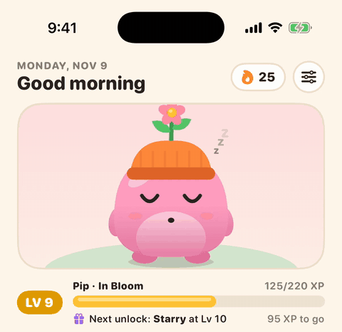
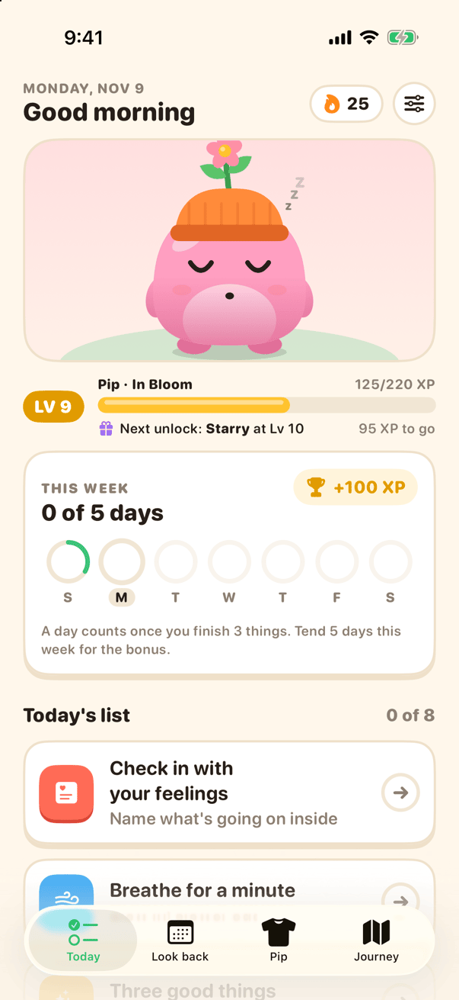
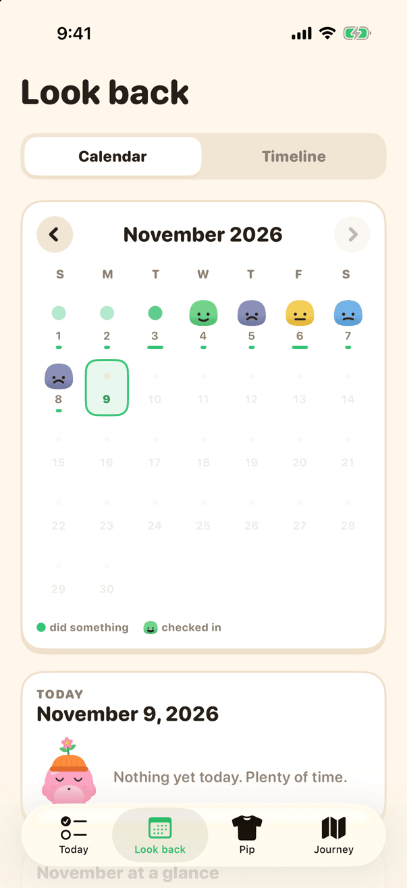
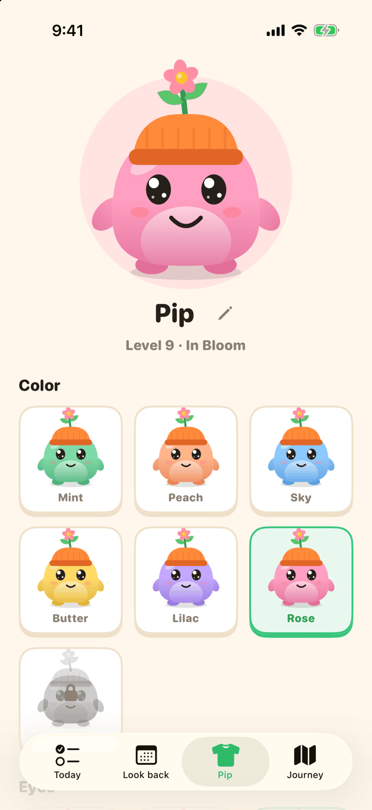
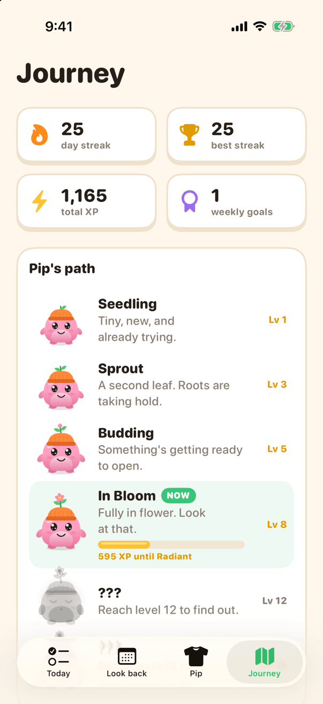

# Tend

A playful SwiftUI iOS app that encourages small daily habits for mental health. Finishing things on your daily list feeds a customizable companion creature that hops, reacts, levels up, and evolves over time.

Built live with Claude Code from a single prompt in my video on building iOS apps with AI agents. More at [cadekukk.com](https://cadekukk.com).

<p align="center">
  
</p>

| Today | Look back | Wardrobe | Journey |
| --- | --- | --- | --- |
|  |  |  |  |

These are the real app in the iOS Simulator (iPhone 17 Pro, iOS 26.5), filled with the made-up history the Debug build generates. To get the same screens, see [Debug launch arguments](#debug-launch-arguments).

## Features

- **Daily checklist** with guided flows for feelings check-ins, one-minute breathing, and three good things
- **Companion** drawn entirely in SwiftUI shapes: idle blinking and breathing, pokeable and squishable, reacts to every completed task
- **Progression**: XP and levels, six evolution stages, a weekly goal (tend 5 days → +100 XP), and a visible "next unlock"
- **Wardrobe** of colors, eyes, patterns, and accessories that unlock with level
- **Look back**: month calendar with mood faces, per-day detail, month summary with mood chart, and a searchable timeline
- **Journey**: streaks, weekly goal history, and the evolution path

All data is stored locally on device in a JSON file. No account or network.

## Getting started

You need a Mac with Xcode 16 or later. The app targets iOS 17+.

1. Download the code: click **Code → Download ZIP** above and unzip it, or run

   ```sh
   git clone https://github.com/cadeKukk/tend.git
   ```

2. Open the project:

   ```sh
   cd tend
   open Tend.xcodeproj
   ```

3. Pick an iPhone simulator from the device menu at the top of Xcode and press ⌘R.

### Run it on your own iPhone

A free Apple ID is enough. No paid developer account is needed.

1. In Xcode, select the **Tend** project, then the **Tend** target, then **Signing & Capabilities**.
2. Under **Team**, choose your Apple ID. Add it first under **Xcode → Settings → Accounts** if it isn't listed.
3. Change **Bundle Identifier** from `com.cadekukk.tend` to something unique to you, like `com.yourname.tend`. Xcode won't sign an identifier that's already registered to someone else.
4. Plug in your iPhone, select it as the run destination, and press ⌘R.
5. The first time, turn on **Settings → Privacy & Security → Developer Mode** on the iPhone, and trust your developer profile under **Settings → General → VPN & Device Management**.

Apps signed with a free Apple ID stop opening after 7 days. Press ⌘R again to reinstall it.

The Xcode project is generated from `project.yml` with [XcodeGen](https://github.com/yonaskolb/XcodeGen). After adding or removing files, regenerate it:

```sh
xcodegen generate
```

## Project layout

| Folder | Contents |
| --- | --- |
| `Tend/App` | App entry point and tab bar |
| `Tend/Model` | Data store, levels and unlocks, companion lines |
| `Tend/Creature` | Companion drawing, accessories, particle effects |
| `Tend/Components` | Theme colors, chunky buttons and cards, shared views |
| `Tend/Screens` | Today, Look back, Wardrobe, Journey, level-up, hatching |
| `Tend/Flows` | Check-in, breathing, and gratitude sheets |

## Debug launch arguments

Debug builds accept these in **Edit Scheme → Run → Arguments** for quickly reaching any state:

| Argument | Effect |
| --- | --- |
| `-reset` | Start fresh from the egg |
| `-demo 9` | Replace all data with random history at about level 9 (weekly bonuses can add a level) |
| `-look rose,sparkle,belly,beanie` | With `-demo`: body, eyes, pattern, accessory |
| `-tab 2` | Open a specific tab (0–3) |
| `-levelup 12` | Show the level-up celebration |
| `-autotap 3` | Complete the habit at that index on launch |
| `-lookback timeline` | Open Look back in timeline mode (or pass days ago) |

`-demo` makes new random data on every launch that includes it, so launch once with `-demo 9 -look rose,sparkle,belly,beanie`, then relaunch with only `-tab` to see the same data on each screen.

## License

MIT. See [LICENSE](LICENSE).
